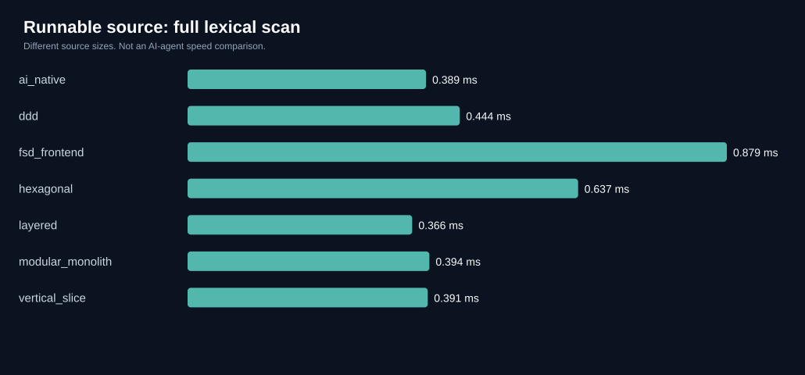
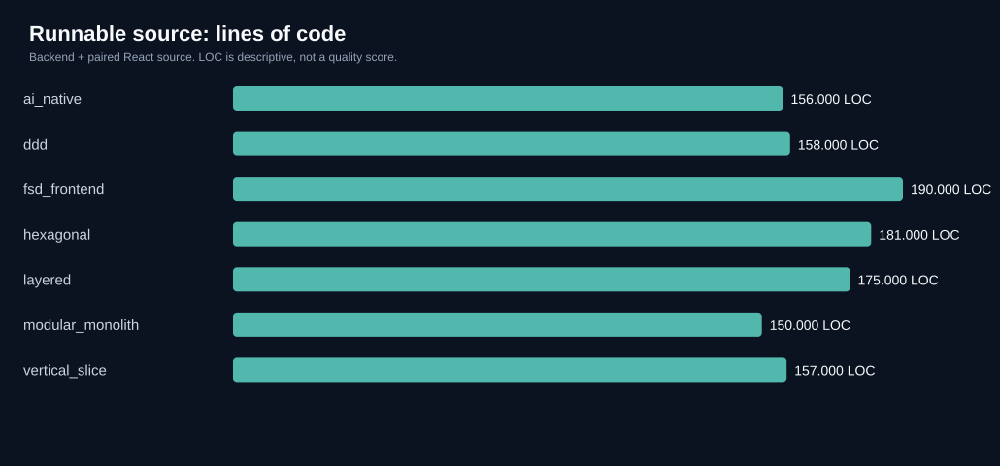

# AI가 가장 잘 탐색하는 아키텍처는 무엇일까? — 실제 실행 코드 비교 실험 2편

> 연구 기록 초안, 2026-11-23. 데이터: `results/runnable/summary.json` · 실측, 단 **AI Agent 실행 결과가 아님**.

## 시작: 이 실험이 답하려는 질문

AI에게 "주문 취소 기능을 바꿔 줘"라고 하면 백엔드, 프론트엔드, 계약, 검증을 넘나들며 코드를 탐색하게 된다. 도메인별 소스 통합 구조가 이 과정에 이점이 있을지 궁금했다.

지난 1편에서는 동일한 7개 소스 파일을 서로 다른 폴더 구조에 배치해 탐색했다. 이번에는 패턴별로 **실행 가능한 예제 코드**를 구현한 뒤, 동일한 HTTP 기능을 통과하는지부터 확인했다.

## 이번에 구현한 구조

- Layered: controller → service → repository.
- Vertical Slice: create/list/cancel 핸들러 중심.
- DDD: OrderAggregate와 도메인 Repository 추상화.
- Hexagonal: port/in, port/out, inbound HTTP/outbound memory adapter.
- Modular Monolith: OrderFacade로 캡슐화한 주문 모듈.
- AI-Native: 한 도메인 디렉터리에서 FE, BE, 명세, API 계약과 테스트를 함께 관리.
- FSD: React app/pages/features/entities/shared 구성. Layered 백엔드와 조합.

이는 서로 배타적인 설계법들이 아니다. DDD+Hexagonal, FSD+DDD 등 조합 가능한 관점들이다.

## 실험 환경과 방법

- Java 21 + Spring Boot, React/Vite, Gradle, Python
- API 계약: 주문 생성(201), 조회(200), 취소(200·멱등), 입력 오류(400), 없는 주문(404)
- JUnit 공통 계약 테스트를 6개 백엔드에 상속 적용
- 동일 검색어 `cancel`, `quantity`, `productName`, `Order`
- 구조당 검색어 4개 × 100회 = 400회 실제 파일 읽기 및 재귀 탐색
- CI 환경과 결과물 생성 시각 및 입력 소스 지문(SHA-256)을 JSON에 저장

각 구조는 **코드가 서로 다르다.** 코드량/경로 구조/파일 수가 동시에 달라지기 때문에 원인 하나를 고립한 벤치마크는 아니다.

## 실측 결과

[실제 데이터 JSON](../results/runnable/summary.json) · [전체 원본 2,800개 CSV](../results/runnable/raw.csv)

| 구조 | 파일 수 | 코드 줄 수 | 탐색 중앙값(ms) |
|---|---:|---:|---:|
| Layered | 7 | 175 | 0.500461 |
| Vertical Slice | 8 | 157 | 0.531620 |
| Modular Monolith | 8 | 150 | 0.534567 |
| AI-Native | 6 | 156 | 0.548593 |
| DDD | 8 | 158 | 0.594622 |
| Hexagonal | 10 | 181 | 0.835692 |
| FSD + Layered | 15 | 190 | 1.133643 |

**주의:** 이 숫자는 Python이 모든 대상 소스 파일을 읽고 문자열을 검색하는 시간이다. 모델의 탐색 지연, 토큰 소비, 기능 구현 정확도, 코드 유지보수성은 측정하지 않는다. 소규모 저장소의 밀리초 미만 차이는 캐시와 실행 환경 영향도 받는다.

## 첫 번째 결론: AI-Native가 가장 빠르다는 증거는 없다

이번 탐색에서는 Layered가 가장 짧은 시간을 기록했다. AI-Native의 성능이 가장 좋을 것이라는 초기 예상에 유리한 결과가 나오지는 않았다. 다만 이 실험만으로 어느 아키텍처가 우수한지 결정할 수도 없다.

오히려 중요한 학습은 **측정 대상을 분해해야 한다**는 것이다. 폴더 배치, 내부 추상화 깊이, 코드량, API 변경 범위, AI에 제공된 문서 수준은 서로 다른 변수다.

## 다음 단계: 진짜 Agent에 기능 구현을 맡긴다

동일한 모델/도구/프롬프트로 기능 수정 과제를 수행하고, 독립 인수 테스트로 성공률과 회귀 오류를 판정하며 토큰/시간/호출 수를 기록할 계획이다. 여러 번 반복해 분산을 보고, 도메인 구조와 AGENTS.md 같은 지침의 효과를 분리한다. **현재 이 단계의 측정 데이터는 없다.**

## 근거 및 재현

- [GitHub 소스 코드](https://github.com/issac-52/AI-Native-Architecture)
- [실행 예제 설명](IMPLEMENTATIONS.md)
- [아키텍처 간 비교 가능성](ARCHITECTURE_COMPARISON.md)
- [실험 프로토콜](EXPERIMENT.md)
- [CI 결과 및 테스트 기록](https://github.com/issac-52/AI-Native-Architecture/actions)

**발행 시 숫자나 결과를 갱신한 경우 본문과 그래프가 동일한 실행 회차를 가리키는지 확인할 것.**
