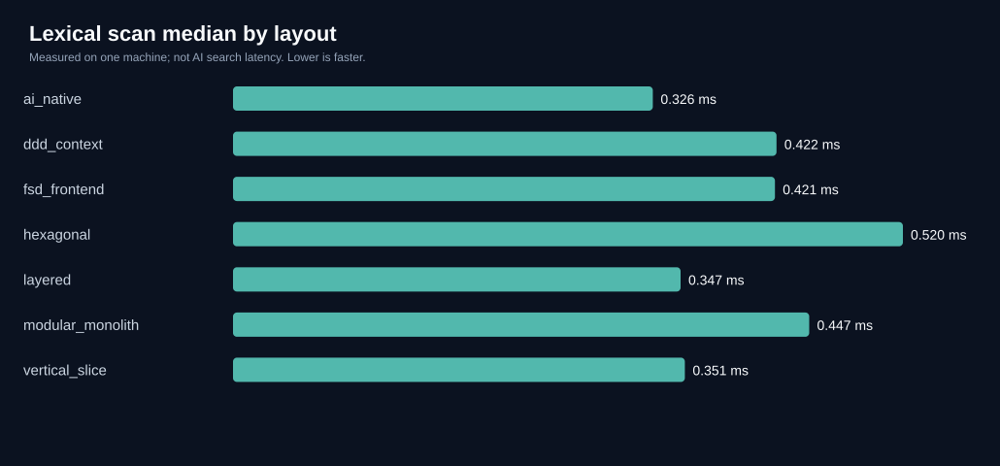
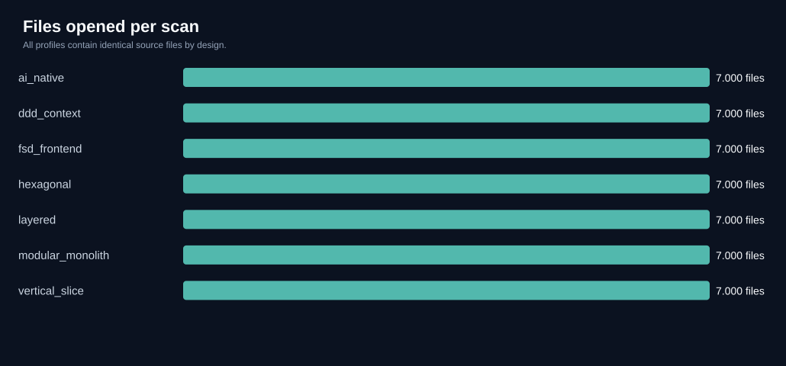

# AI가 코드를 직접 수정하는 시대, 아키텍처의 기준은 달라질까?

> 발행 전 업데이트할 연구 초안 · 2026-11-23
>
> **주의:** 아래 결과는 AI 성능 벤치마크가 아니라 실제 파일 시스템에서 수행한 **소스 경로 배치 탐색 마이크로벤치마크**다.

## 문제의식

오늘날의 웹 애플리케이션에서는 프론트엔드·백엔드 소스가 별도의 디렉터리나 저장소에 나뉘어 있는 경우가 많다. 하지만 AI Agent에게는 “주문 취소 기능”처럼 비즈니스 단위의 요구사항을 주고, 관련 코드를 모두 찾아 수정하게 될 수도 있다.

그렇다면 프론트엔드와 백엔드를 주문 도메인 근처에 배치하는 것이 AI 작업의 맥락 수집에 유리할까?

## 비교 대상으로 무엇을 선택했나

1. 계층형 — controller / service / repository 및 별도 frontend.
2. Vertical Slice — 기능 단위로 코드 묶기.
3. DDD bounded context — 비즈니스 모델·경계 중심.
4. Hexagonal — ports & adapters와 의존성 방향.
5. FSD — 프론트엔드 layer / slice / segment.
6. Modular Monolith — 단일 배포 단위 내부 모듈화.
7. AI-Native 도메인 통합 — 동일 도메인 근처에 FE·BE·계약·명세 배치.

이들은 **동일한 분류 축이 아니다.** 예컨대 DDD와 헥사고날은 조합할 수 있고 FSD는 프론트엔드에 특히 적합하다. 따라서 “전통 아키텍처의 우열”이 아니라 여러 설계 관점을 반영한 *파일 배치 대리 실험*이라고 표현해야 한다.

## 실험 1: 동일 코드, 다른 폴더 배치

파일 내용이 다른 경우 탐색 비용의 차이가 코드 구현 방식에서 발생할 수 있기 때문에, 첫 실험에서는 **7개의 동일한 원본 소스 파일**을 7가지 디렉터리 배치로 복제했다.

- 검색어: `cancel`, `quantity`, `productName`, `Order`
- 각 검색어·구조 조합을 100회 측정
- 검색은 전체 디렉터리를 순회하여 모든 Java·JSX 파일 내용을 읽는 단순 키워드 검사
- 측정 대상: 전체 순회와 파일 읽기에 걸린 시간, 열린 파일 수, 읽은 바이트, 검색 결과 수
- 테스트 장비/실행 환경/UTC 시간/입력 SHA는 자동으로 JSON·CSV에 기록

## 첫 결과

정확한 숫자는 [실측 결과 보고서](../results/latest/RESULTS.md)에서 확인할 수 있다.

이 실험에서 **모든 구조는 동일하게 7개 파일과 6,531바이트**를 읽었다. 밀리초 미만의 시간 차이는 파일시스템 캐시, 경로 길이, 런너 상태 등에 의해 흔들릴 수 있다.

따라서 여기서 AI-Native 구조가 더 뛰어나다고 결론을 내릴 수 없다. 특히 **AI 모델 호출 시간, 토큰 사용량, 코드 변경 성공률, 회귀 오류**는 측정하지 않았다.

## 실험 설계의 교훈

- 폴더 배치를 다르게 만드는 것만으로 실제 DDD·FSD·헥사고날 구현의 장단점을 측정할 수는 없다.
- Agent가 무조건 전체 검색을 하면 동일한 코드 양에서는 결국 비슷한 비용을 지불한다.
- 도메인 manifest, AGENTS.md, 검색 인덱스 등의 문서 효과를 물리적인 폴더 배치와 분리해야 한다.
- 현재의 7개 파일 실험으로 규모가 큰 실서비스의 결과를 추정할 수 없다.

## 다음 실험: 진짜 AI Agent가 기능을 수정하게 만들기

주문 수량 상한 변경, 상품명 검색, API 필드 추가, 취소 정책 변경 등을 동일한 모델·동일한 시간/토큰 예산으로 실행한다. 각 시도는 독립된 작업 트리에서 진행하고, Agent가 수정할 수 없는 인수 테스트로 검증한다. 정확도와 회귀 오류를 주요 지표로, 토큰·소요시간·탐색 호출을 보조 지표로 누적한다.

가설은 여전히 열려 있다. AI Agent를 위한 좋은 아키텍처는 아마 단순히 소스 파일을 붙여놓는 것보다 **도메인 경계, 요구사항 명세, 공개 계약, 독립적 검증 규칙**에 더 많이 달려 있을 것이다.

## 참고 자료

- [FSD 공식 문서](https://feature-sliced.design/docs/get-started/overview)
- [AWS Hexagonal Architecture 및 DDD](https://docs.aws.amazon.com/prescriptive-guidance/latest/hexagonal-architectures/overview.html)
- [Microsoft의 웹 애플리케이션 아키텍처 비교](https://learn.microsoft.com/en-us/dotnet/standard/modern-web-apps-azure-architecture/common-web-application-architectures)

## 공개 시 유의사항

이 글에서 “7개 아키텍처의 AI 성능을 비교했다”, “AI-Native가 X% 빠르다”라는 표현은 사용하지 않는다. **7개 파일 배치의 반복 측정**이라고 정확하게 서술하며, 후속 AI Agent 실험 결과가 확보되면 별도 글로 발행한다.
