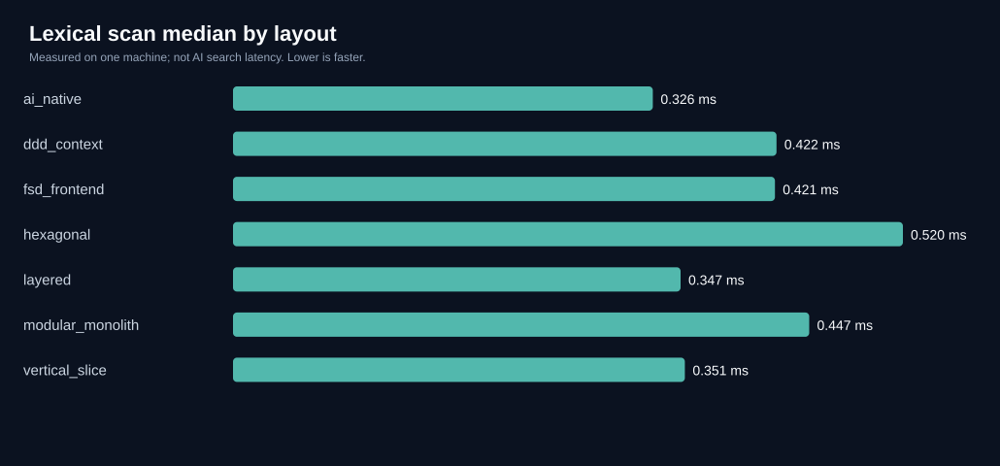
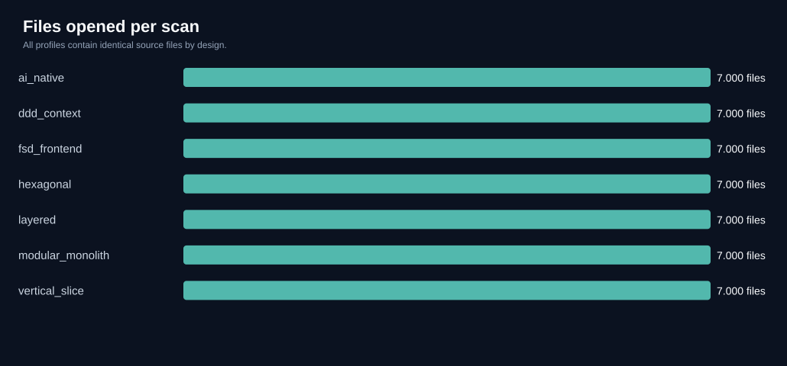

# Measured path-layout microbenchmark

> **NOT AI performance evidence.** Identical source bytes, different paths; full lexical file scans.

- UTC: 2026-11-23T06:53:59.267459+00:00
- Platform: Linux-7.0.0-1020-azure-x86_64-with-glibc2.43
- Source SHA-256: \`001ec0f47b659cc23692c0d556f87814ba561377c180dcd12e41b21b427de104\`
- Repetitions per profile/query: 100
- Random seed: 20261123

| Profile | Median of query medians (ms) | Files opened | Bytes read |
|---|---:|---:|---:|
| ai_native | 0.324706 | 7 | 6531 |
| ddd_context | 0.420517 | 7 | 6531 |
| fsd_frontend | 0.419370 | 7 | 6531 |
| hexagonal | 0.518307 | 7 | 6531 |
| layered | 0.346946 | 7 | 6531 |
| modular_monolith | 0.444484 | 7 | 6531 |
| vertical_slice | 0.348414 | 7 | 6531 |

## Interpretation
This records real elapsed time on the named machine, not AI tokens, task success or semantic comprehension.
Measurements may differ because of filesystem/cache noise and path lengths; do **not** infer architectural superiority.
DDD, hexagonal and FSD are deeper design patterns that this paths-only fixture cannot fully implement.
A proper agent experiment additionally requires pinned model, identical tasks, independent acceptance tests, repeated trials and tokens.

Raw observations: [raw.csv](raw.csv) · Per-query summaries: [summary.csv](summary.csv).
