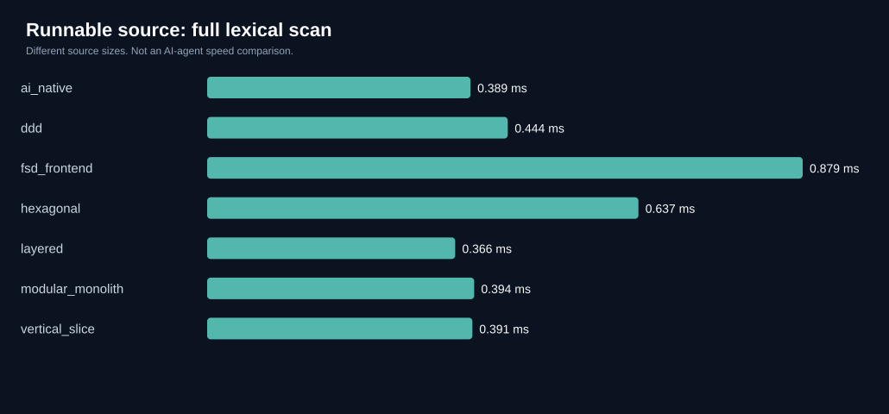
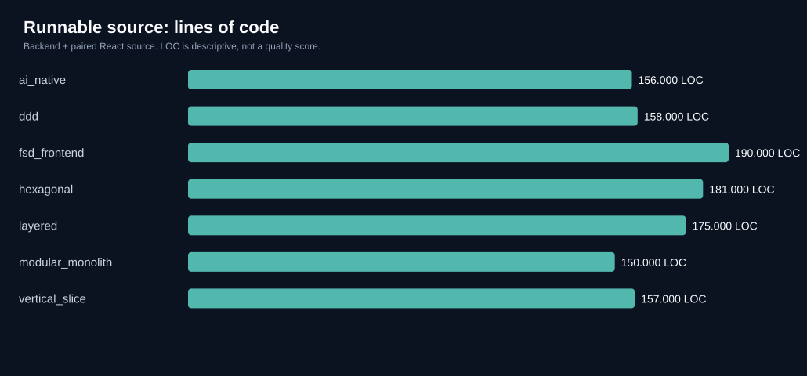

# Measured runnable-source comparison

> **NOT a comparison of AI reasoning or AI coding productivity.** Actual code
> from runnable architecture examples, searched by a Python lexical scanner.

- UTC: 2026-11-23T07:00:35.824182+00:00
- Platform: Linux-7.0.0-1020-azure-x86_64-with-glibc2.43
- Repetitions: 100 per profile/query
- Seed: 20261123

| Profile | Source files | Source LOC | Source bytes | Scan median (ms) |
|---|---:|---:|---:|---:|
| ai_native | 6 | 156 | 5857 | 0.548593 |
| ddd | 8 | 158 | 6721 | 0.594622 |
| fsd_frontend | 15 | 190 | 7791 | 1.133643 |
| hexagonal | 10 | 181 | 7599 | 0.835692 |
| layered | 7 | 175 | 6531 | 0.500461 |
| modular_monolith | 8 | 150 | 6304 | 0.534567 |
| vertical_slice | 8 | 157 | 6254 | 0.531620 |

## Interpretation
- Each profile scans its full paired backend and frontend sources. These source files **differ**.
- Extra abstractions naturally increase LOC/paths; no performance ranking is justified.
- Shared HTTP contract tests measure functional parity, not coding-agent success.
- A real AI benchmark requires the same agent, task, token budget, fresh checkouts and independent acceptance tests.

Evidence: [raw.csv](raw.csv), [summary.csv](summary.csv), [summary.json](summary.json).

Each profile's source roots and a SHA-256 fingerprint are recorded in summary.json.
